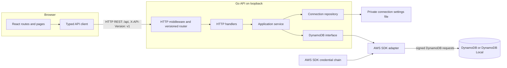
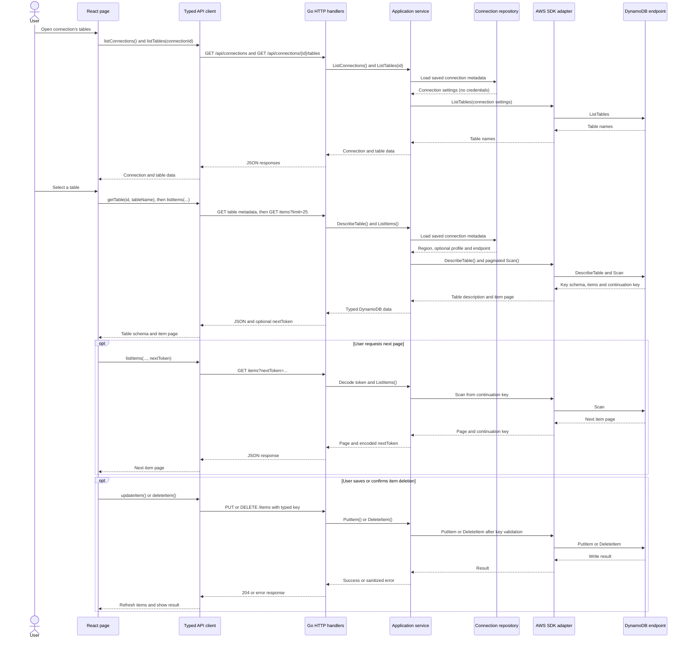

# DynamoDB Manager

A local web application for configuring DynamoDB connections, browsing tables and items, filtering records, and editing or deleting items. The frontend is a Vite/React/TypeScript app; the Go API uses chi and the AWS SDK for Go v2.

## Architecture and security boundary

The diagram shows the runtime layers and the two backend dependencies: connection metadata is stored locally, while table operations go through the AWS SDK to the configured DynamoDB endpoint.



The sequence below illustrates the browser-to-backend path for browsing and editing records. Pagination tokens carry the DynamoDB continuation key back to the API; item writes are validated against the table's complete primary key before the SDK call.



The initial deployment is a trusted, local, single-user tool. The API is unauthenticated and must not be exposed to a LAN, public interface, reverse proxy, or other untrusted network. The backend binds to loopback by default. Add authentication and access controls before changing that boundary.

The browser communicates only with the API; it does not receive AWS credentials or access DynamoDB directly. The backend persists only non-secret connection settings (name, region, optional shared-profile name, and optional endpoint). AWS credentials are resolved using the AWS SDK's normal environment/shared-profile credential chain and are never persisted by the application, returned, or logged. Never put credentials in browser storage, connection payloads, `.env`, or source control.

Browsing uses paginated DynamoDB `Scan`, with a maximum page size of 100 and at most one optional equality filter. A filter does not turn a Scan into an indexed query and may still incur substantial read capacity. The application does not expose arbitrary AWS operations. Item writes require the complete table primary key; deletes require explicit confirmation in the UI.

The TailAdmin free dashboard is used only as visual inspiration. No template code or assets are copied. The application icon in `assets/dynamodb-manager.svg` is original.

## Prerequisites

- Node.js **22.12+** and PNPM (the frontend uses Vite 6).
- Go **1.23+**.
- `make`.
- Docker Engine/Desktop with Docker Compose v2 for local DynamoDB and integration tests.

## Configuration

Copy `.env.example` to `.env` to customize the DynamoDB Local host ports used by Compose. The test service uses `DYNAMODB_LOCAL_PORT` (default `8000`); the seeded dev service uses `DYNAMODB_DEV_PORT` (default `8001`). No secrets belong in this file. The backend stores connection metadata in `${user-config-dir}/dynamodb-manager/connections.json` with private file permissions; set `DYNAMODB_MANAGER_CONFIG` to override the location.

Configure AWS access for the **backend process** using the standard SDK credential chain (for example `AWS_PROFILE` and `AWS_REGION`, or supported AWS environment credentials). Connection profile and region are settings, not credentials. Backend options and API details are in [`backend/README.md`](backend/README.md).

## Install, run, and build

From the repository root:

```sh
make help
make install
make run             # frontend dev server, proxies /api to localhost:8080
make run-backend     # API at 127.0.0.1:8080
make build
```

Run `make run` and `make run-backend` in separate terminals. The Vite development proxy forwards `/api` to the Go API. If port 8080 is occupied, choose another loopback port for both processes, for example `DYNAMODB_MANAGER_ADDR=127.0.0.1:8081 make run-backend` and `DYNAMODB_MANAGER_API_TARGET=http://localhost:8081 make run`. For AWS access, set the credential-chain environment in the backend terminal before starting it. Frontend configuration and scripts are documented in [`frontend/README.md`](frontend/README.md).

All `/api` requests require `X-API-Version: v1`; `/health` is unversioned. The backend accepts configured Vite origins and does not enable credentialed CORS.

## Local DynamoDB containers

```sh
make dev-up          # start persistent DynamoDB Local and seed demo tables/items
make dev-down        # stop containers; the container data is preserved
make dev-recreate    # recreate containers and reset/reseed demo data
make test-up         # start an empty, in-memory DynamoDB Local for manual testing
make test-down
make test-recreate
```

The dev environment exposes DynamoDB Local at `http://127.0.0.1:8001` by default and creates `DemoProducts` (partition key `id`) and `DemoOrders` (composite key `customerId` + `orderId`) with representative typed attributes. `make dev-down` stops but keeps the container and its data; `make dev-up` starts it again without overwriting existing items. `make dev-recreate` removes the container and resets/reseeds the demo data. To browse them in the UI, add a connection with region `us-east-1` and endpoint `http://127.0.0.1:8001`. DynamoDB Local still expects signed requests; if the backend has no AWS credentials configured, start it with disposable local-only credentials, for example `AWS_ACCESS_KEY_ID=dummy AWS_SECRET_ACCESS_KEY=dummy AWS_REGION=us-east-1 make run-backend`. Never use real AWS credentials for local DynamoDB.

The test container in `docker/test.yaml` is in-memory and isolated from dev data. `make test-integration` starts and removes that test service automatically.

## Tests and quality checks

```sh
make test-unit         # frontend tests and Go unit tests; no Docker/AWS required
make test-integration  # starts DynamoDB Local, runs the Go integration test, cleans up
make test              # unit plus integration tests
make lint              # frontend TypeScript check and Go vet/format check
make format            # frontend formatter if configured and gofmt
make clean
```

Docker is required only for `make test-integration` (and `make test`). Integration uses disposable local credentials and `DYNAMODB_LOCAL_ENDPOINT`; it does not access AWS. The Compose service binds to `127.0.0.1` and runs in-memory. Override the host port with `DYNAMODB_LOCAL_PORT`.

## Project layout

- `frontend/` — routed React application and browser tests.
- `backend/` — versioned HTTP API, use cases, DynamoDB adapter, and tests.
- `docker/` — dev and test Docker Compose configurations plus demo fixtures.
- `assets/` — original application artwork.
- `agents/README.md` — ownership and collaboration conventions.
- `scripts/` — shell implementations for Makefile tasks and demo-data seeding.
- `Makefile` — common install, run, build, test, lint, format, and clean commands.

## License

MIT; see [`LICENSE`](LICENSE).
